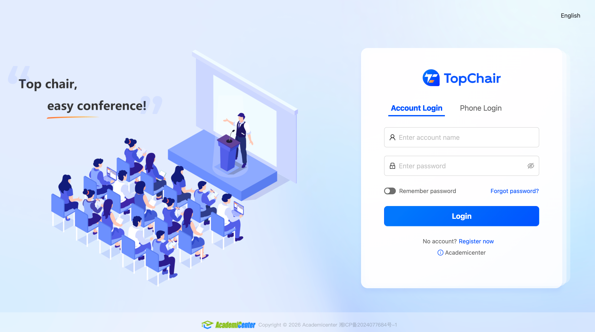
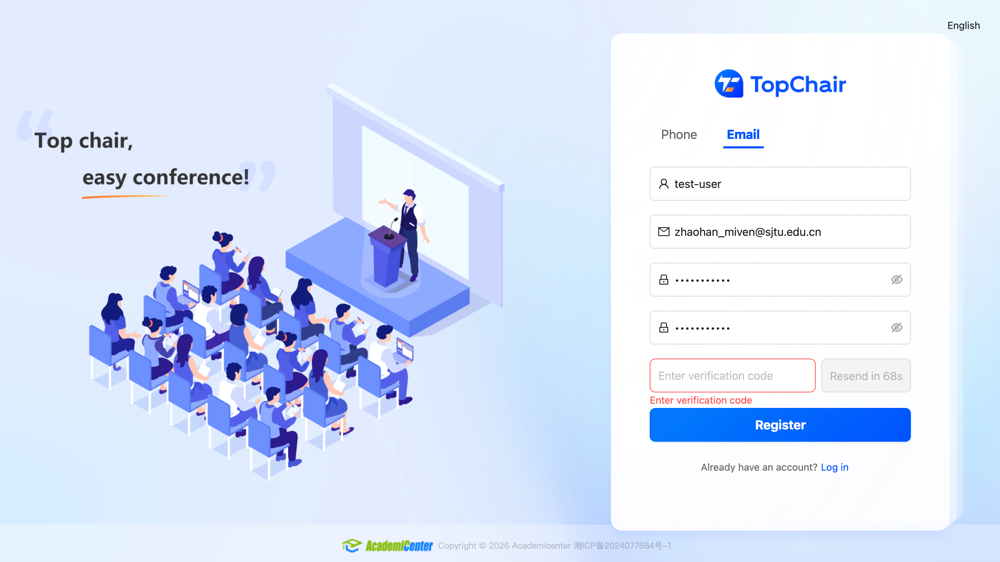
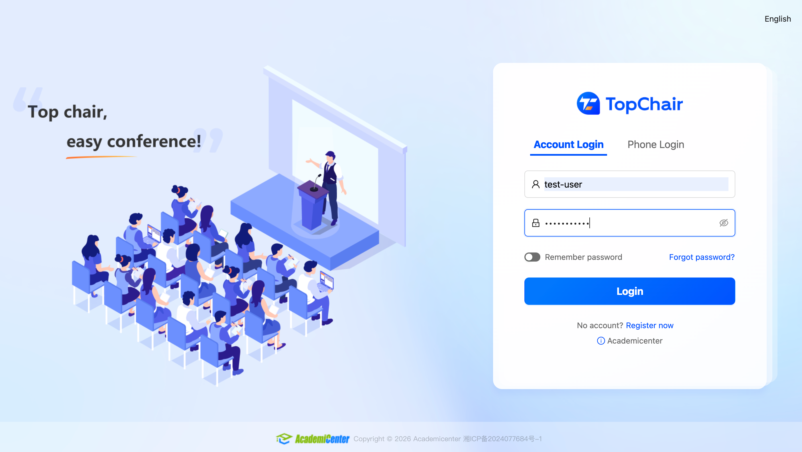
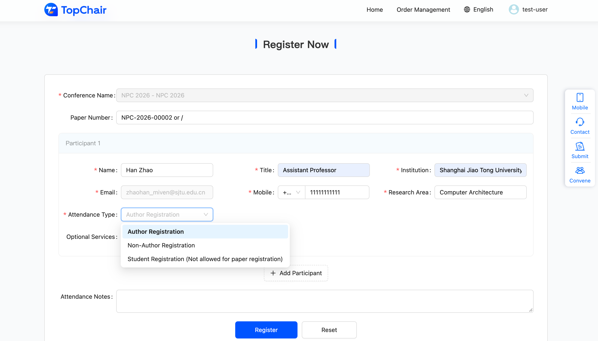
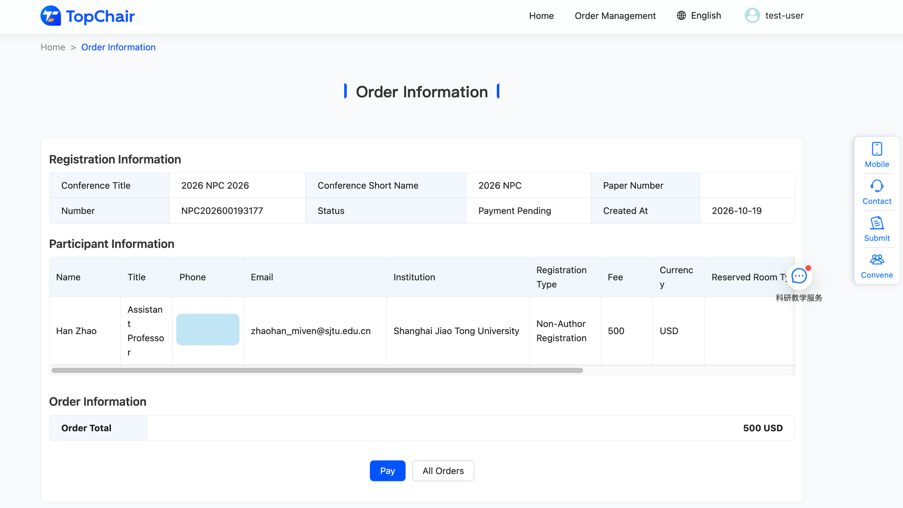

## How to Register

### Step 1: Open the registration page.

When you open the registration website, you will see the login page below. Click **Register now** to create an account.

[Register Here](https://topchair.academicenter.com/registration/2109472040138280960/){ .md-button .md-button--primary target="_blank"}

### Step 2: Create an account.

After you click **Register now**, you will see the page below. You can sign up with either your **phone number** or your **email address**.

### Step 3: Log in.

Once your account is created, you will see the page below. Log in to the system.

### Step 4: Fill in your registration details.

Fill in the required information. Please note:

- Each accepted paper requires one **Author Registration**. Other authors of the same paper may choose a **Non-Author Registration** or a **Student Registration**.
- For each **Author Registration**, enter the corresponding **Paper Number**.
- A **Student Registration** cannot replace an **Author Registration**.

### Step 5: Pay the registration fee.

You will see the page below. Click **Pay** to go to the payment page, where you can pay with **Mastercard** or **Visa**.

### Step 6: Receive your invitation letter.

After payment, we will send an invitation letter to your email address within **6 hours**. If you have any questions about the invitation letter, please email us at zhao-han@cs.sjtu.edu.cn.

